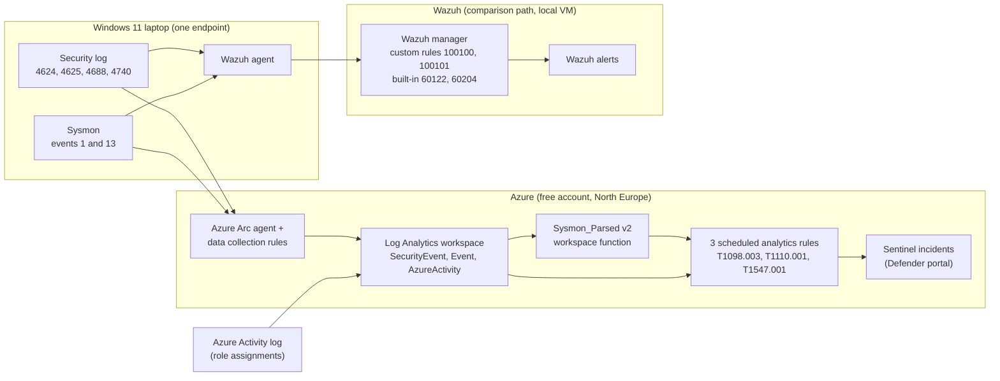

# Phase 3 - Microsoft Sentinel cloud SOC lab

Phase 3 of soc-home-lab. Phase 1 (phase1-detection) built Wazuh detections on a Windows laptop and phase 2
(phase2-pipeline) built an AI alert-triage pipeline. This phase builds detections in Microsoft Sentinel, ports
them to KQL, validates each one with a controlled test, and compares Sentinel with Wazuh on the same endpoint.

## Environment

- Azure free account with the spending limit on, a resource group for the lab, and a Log Analytics workspace
  with Microsoft Sentinel (North Europe; West Europe refused new customers and Spain Central did not support
  Sentinel). Daily ingestion cap 0.5 GB/day; observed volume about 1-14 MB/day. Sentinel free trial.
- One Windows 11 laptop onboarded to Azure Arc. Data collection rules send Security events 4624, 4625, 4688
  and 4740 (SecurityEvent) and Sysmon events 1 and 13 (Event table). The same Sysmon and Security events also
  feed a self-hosted Wazuh manager in a VM.
- Workspace function Sysmon_Parsed (v2) turns Sysmon EventData XML into columns and carries an IngestTime column.
- Work was done in the Defender portal; functions were saved from the workspace Logs page.

## Architecture

The same Security and Sysmon events feed both paths. T1098.003 reads the Azure Activity log, which only Sentinel
receives; the endpoint rules (T1110.001, T1547.001) can be compared with Wazuh.

## Detections

| Rule | MITRE | Data | Files |
|---|---|---|---|
| Privileged Azure role assigned | T1098.003 | Azure activity | detections/T1098.003-privileged-role.kql, .rule.json |
| Repeated failed logons (5+ in a 10-minute sliding window) | T1110.001 | SecurityEvent 4625 | detections/T1110.001-repeated-failed-logons.v0.3.kql, .rule.json |
| Registry Run/RunOnce key write | T1547.001 | Sysmon event 13 | detections/T1547.001-run-key.kql, .rule.json |

Each rule is a scheduled analytics rule with entity mapping and custom details, exported as an ARM template
(detection as code) and tagged in git (t1098.003-v1.0, t1110.001-v1.0, t1547.001-v1.0). Earlier query versions
are kept for history. The T1098.003 rule has dynamic severity; its High path was validated with an Owner assignment (incident 10, High).

## How each rule was validated

Every rule was run against benign data (no alert expected) and a controlled test (alert expected): role
assignments in Azure for T1098.003, runas with wrong passwords against a local test account for T1110.001, and an
Atomic Red Team test 1 command for T1547.001 (value removed immediately, cleanup verified). Results, including
one failure that was fixed, are in validation-matrix.md. Cases not yet tested are listed there in their own table.

## Results

| Rule | Observed time from action to Sentinel alert/incident |
|---|---|
| T1098.003 | about 13 min (two tests), 21 min 17 s (Owner test) and 10 min 13 s (Contributor test on rule v1.1); event time to incident creation; this rule runs every 15 minutes, the other two every 10 |
| T1110.001 | 8 min 43 s (live burst, first failed logon to alert), 14 min 0 s (boundary test with 5 failures); about 9 and 10 min in earlier tests |
| T1547.001 | about 9 min and about 13.5 min (two separate tests) |

Wazuh raised its alerts in about a second in the tests where its server was running. These are single
measurements on one endpoint, not performance figures. See comparison/wazuh-vs-sentinel.md.

## Documents

- validation-matrix.md - test cases, expected and actual results.
- comparison/wazuh-vs-sentinel.md - coverage, latency, benign behaviour, correlation, limitations.
- investigations/IR-001-T1110.001-repeated-failed-logons.md - incident report with an evidence/inference table.
- notes/build-log.md - step-by-step log, including mistakes and corrections.
- notes/test-log.md and screenshots/ - evidence. Screenshots have the local username redacted.
- infrastructure/ - the two data collection rules exported as ARM templates (subscription ID replaced by a placeholder).
- sigma/, playbooks/, workbooks/ - reserved for stretch items.

## Telemetry reliability

Checked on 2026-10-20 over the last 7 days (screenshots/44-telemetry-freshness.png, 45-ingestion-volume.png):

| Source | Events (7 days) | What it feeds |
|---|---|---|
| SecurityEvent (laptop) | 20,564 | T1110.001 |
| Event, Sysmon (laptop) | 7,188 | T1547.001 |
| AzureActivity (tenant) | 338 | T1098.003 |

- Both laptop sources stopped at the same moment, 21:50 on 2026-10-19, and were still silent 974 minutes later,
  because the laptop was off. AzureActivity kept arriving, since it does not depend on the laptop.
- If a source stops, the rules that read it detect nothing, and no rule alerts on the silence itself. The laptop
  rules (T1110.001, T1547.001) are blind whenever the laptop sends nothing; T1098.003 is blind if Azure activity
  stops arriving. A rule on the last-event time per table would cover this; it is not built.
- Billable ingestion over 7 days was about 1 to 14 MB per day (SecurityEvent 0.81-5.66 MB, Sysmon 4.39-10.69 MB),
  under 3% of the 0.5 GB/day cap. The highest day was 2026-10-18. There was no billable ingestion recorded for
  2026-10-17. If the cap were reached, collection would stop for the rest of the day; this was not tested.
- Sysmon_Parsed v2 carries an IngestTime column (ingestion_time() is empty after the function reshapes the rows),
  which the rules use to alert only on newly ingested events.

## Cost

On 2026-10-16 (day 5 of the lab) the Azure portal showed EUR 0.04 incurred this month and EUR 175.96 of the EUR 175.99 free credit still available (screenshots/33-azure-cost.png). No per-service breakdown was captured. The credit expires about 25 days after that date, shortly before the Sentinel trial ends. Controls in place: spending limit on (never upgraded), a budget with alerts, and the 0.5 GB/day cap. The final figure is added at close-out.

## Lessons learned

- Azure log field names vary in case (camelCase and PascalCase); the first T1098.003 query missed events until it
  coalesced both.
- A Sysmon XPath with leading whitespace made the collection agent fail (error 15007).
- Fixed time bins can split a burst across a boundary; a sliding window avoids that.
- ingestion_time() returned empty after a function reshaped the rows. Reading it before the reshaping fixed it,
  and rules can then alert only on newly ingested events.
- An alert takes its event time from a TimeGenerated column; without one, the incident showed the query window.
- LogonProcessName is stored with a trailing space; Sysmon logs HKCU writes under HKU\<user SID>.
- Passwords were typed at a prompt so they never appeared in the command-line logs that are collected.
- Both SIEMs flagged a legitimate browser-updater Run-key write as a false positive. Neither rule has an
  allow-list yet.
- Sentinel produced a duplicate incident for that one event; it did not reproduce and the cause was not found.
- Wazuh delivers queued events late when its server is off, and its alert time is then the index time.

## Limitations

One endpoint, one lab, small samples, simulated attacks on my own machine. Network and RDP failed logons,
password spraying and cloud attacks beyond role assignment were not tested. Sentinel was used on a free trial and
the cost after the trial was not evaluated.

## Status

The three core detections, their validation, the comparison and the incident report are complete. Planned
stretch items: T1082 and T1087 ports, a workbook, a playbook, and
the v0.4 rule improvements described in the incident report. Test accounts and role assignments are removed at
the end of the project.

## Privacy

No subscription or tenant IDs, email addresses, public IPs or local usernames are published. Raw alerts and
exports contain the local username and user SID and are kept out of the repo.

